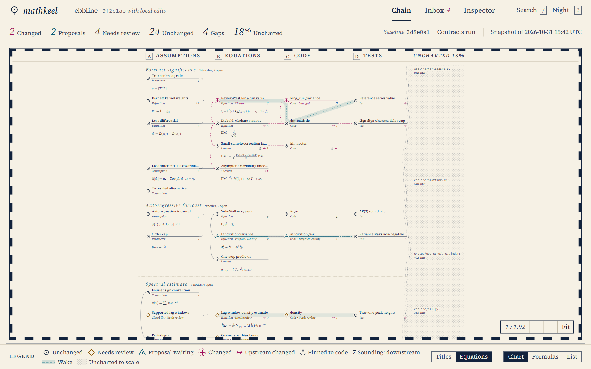

# mathkeel

<div align="center">

[](https://en.wikipedia.org/wiki/Command-line_interface)
[](https://www.typescriptlang.org/)
[](https://nodejs.org/)
[](https://react.dev/)
[](#how-it-works)

[](https://semver.org/)
[](LICENSE)
[](skill/mathkeel)
[](#privacy-and-security)

</div>

**Know when the mathematics your code documents has changed.**

mathkeel anchors each documented statement to its text and its code, runs
independent checks on request, and keeps a chart of what still holds. When a
documented result changes, an agent proposes whether it is an error, and you
decide. It works beside a coding agent without entering its context, on Python
and Rust repositories documented in Markdown, LaTeX or docstrings.



*The chain view, drawn from a synthetic fixture.*

mathkeel says "this documented result changed". Proof and correctness stay with
you: it reports the state of each statement and leaves the verdict to a person.

mathkeel is built to be driven by a coding agent such as Claude Code or Codex.
The agent writes the map and the contracts under `.mathkeel/`, queries the chain
and proposes verdicts on alerts. You choose which chain to map, review the map,
and make the decisions. You do not write the map by hand. What an agent reads or
writes is [TOON](https://github.com/toon-format/toon) rather than JSON, to spend
fewer tokens.

## How it works

1. **Controls** see that a documented result changed. Anchors survive comments,
   formatting and local renames, and an anchor change alone never raises an alert.
2. **An independent agent** proposes `error`, `legitimate` or `uncertain`, with
   its reason.
3. **You decide** with `mathkeel accept`. The skill forbids agents to run it, and
   the UI only shows the command to copy. Every decision is logged in
   `.mathkeel/decisions.jsonl` with the Git user, time and commit, so you can
   audit who accepted what.

Code that nobody has mapped stays visible as fog on the chart, so you always see
what mathkeel covers.

## Quickstart

Build mathkeel from source. You need Node 20 or later and Git, and the demo also
needs Python.

```bash
git clone https://github.com/danieleb1861/mathkeel.git
cd mathkeel
npm install
npm run build
npm link --workspace packages/core
node eval/run.mjs
```

The last command runs seven demo cases and ends with `all 7 passed`. In your own
repository, you normally ask your agent to map a chain and it runs the commands
below. They are listed so you can see what it does, or run them yourself:

```bash
mathkeel init
# The agent describes one chain in .mathkeel/map.toon, as in skill/mathkeel/references/mapping.md
mathkeel map lint
mathkeel map freeze
mathkeel status
mathkeel check
mathkeel serve
```

Copy `skill/mathkeel` into your agent's skills folder (for example
`~/.claude/skills` or `~/.codex/skills`) to map and query a chain from Claude
Code, Codex or another Agent Skills client. The skill is the intended way to use
mathkeel; the `mathkeel` command must still be on your `PATH`.

## Commands

| Command | Purpose | Runs code |
| --- | --- | --- |
| `status` | Anchors, gaps and uncharted share | No |
| `check` | Status plus your declared contracts | Yes, after listing them |
| `map lint`, `map freeze` | Validate and record the map | No |
| `impact`, `trace` | Follow a file, symbol or node | No |
| `judge pack`, `judge apply` | Prepare alerts for an agent, then apply its proposals | No |
| `accept` | Record your decision and rebaseline | No |
| `serve`, `export` | Local live chart or offline HTML | No |
| `export --graph` | The map as a graph that Graphify can merge | No |
| `suggest <graph>` | Unmapped files linked to mapped code; adds nothing | No |

`status`, `check`, `impact` and `trace` take `--toon` or `--json` for structured
output. `check` and `judge apply` exit 1 while alerts or reviews remain, so a
verdict alone cannot turn continuous integration green. Exit code 2 means a usage
or map error. In a non-interactive shell, `check` needs `--yes` to run contracts.

## Evaluation

The design went through blinded benchmarks on one Python forecasting repository.
One agent built the map and a separate agent wrote labelled code changes. Results
on the 137 changes unseen by the rule set:

| Measure | Controls alone | With judge |
| --- | --- | --- |
| Alert precision | 0.84 | 0.98 |
| Mathematical errors found | 71% | 71% |
| Subtle errors found | 68% | 68% |
| Neutral changes without an alert | 100% | 100% |
| Legitimate changes without an alert | 67% | 100% |

Errors found reached 43 of 44 in well-mapped modules and 4 of 22 in barely
mapped ones: the map's coverage drives detection. Scope: artificial changes on
one repository, one judge run, with the judge reading JSON packs (v0.1 writes
TOON). The benchmark data are kept outside this repository; `eval/run.mjs`
reproduces the demo cases.

### A run on a real repository

We then ran v0.1 on
[BESS_sizing_tool](https://github.com/danieleb1861/BESS_sizing_tool), about 1,600
lines of Python with no tests at the start, which accompanies a published paper. One
agent wrote the specification from the paper and the README, then 44 nodes and 44
contracts in four chains.

| Measure | Result |
| --- | --- |
| Contracts run on the starting commit | 43 |
| Contracts failing on it | 12 |
| Written before the agent read the function bodies | 32 of 43 |
| Failures that exposed a real crash | 1 |
| Commits that changed mapped code during the run | 4 |

The failing contracts pointed, among other findings, to a call that crashed the
KPI step and to README data formats that the loader refused. Commits made during
the run fixed six of the twelve. When a later commit rewrote the solver, `check`
flagged the affected contracts at once, and `status` had already queued the
changed symbols.

Scope: one repository, with one agent writing both the map and the contracts.
Expected values came from the documentation; 11 of the 43 contracts were added
after reading the code, and four were corrected during the run. The run measures
what mathkeel found, not recall, and leaves the verdict on each failure to a
person.

### Token cost

`eval/tokens.mjs` measures what an agent must read to answer fixed questions with
the same evidence in every arm. It counts text with cl100k_base and does not run an
agent. `exact` is a search that already knows the right terms, so it is an
unbeatable rival. `keyword` greps one word of the question, and `whole` reads each
file that holds the evidence.

| Measure | Demo | BESS_sizing_tool |
| --- | --- | --- |
| Mapped questions | 2 | 10 |
| Saved against `exact` | -14% | 10% (median 0%) |
| Saved against `keyword` | 47% | 56% |
| Saved against `whole` | 41% | 72% |
| Questions to repay the map, against `keyword` | 8 | 25 |
| Questions to repay the map, against `whole` | 11 | 9 |
| One-off cost of the map, in tokens | 1,927 | 27,767 |

mathkeel pays off by replacing guessed searches and whole-file reads, mostly on
impact questions, and stays close to even with a search that already knows the
right terms. On unmapped questions the overhead is small: 26 tokens over two
questions on BESS_sizing_tool. The one-off cost covers the map, the contracts and
reading their anchors. The questions were chosen after building the map, so the
figures are indicative.

`node eval/tokens.mjs` reproduces the demo column. The questions behind the
BESS_sizing_tool column are in `eval/tokens.bess.json`; that column also uses the
repository's map.

## Privacy and security

mathkeel makes no network calls at runtime and has no telemetry. It skips `.env`,
keys and binary data, and respects `.gitignore`. Contracts are code, so review
them like code: they run only on `mathkeel check`. `serve` binds to 127.0.0.1,
requires a random token, and stops with its process.

## Status

v0.1, tested on Windows with Node 24 and on Chromium; the build, tests and demo
pass. Rust parsing uses a pinned grammar version; very recent syntax may need a
grammar update. macOS, Linux, Node 20,
Firefox and Safari are the next platforms for the test matrix.

## License

[MIT](LICENSE). The UI bundles third-party works under their own licenses, listed
in [`packages/ui/NOTICE`](packages/ui/NOTICE).
